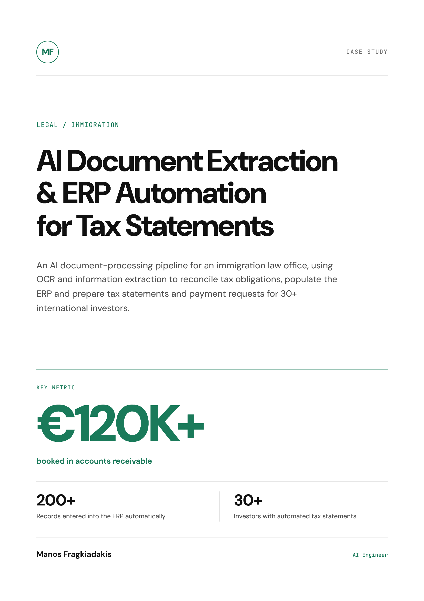
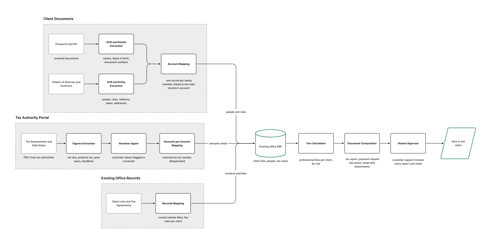

# AI Document Extraction & ERP Automation for Tax Statements

**An AI document-processing pipeline for an immigration law office, using OCR and document extraction to cross-reference tax obligations, populate an existing ERP, and prepare tax statements and payment requests for 30+ international investors.**

## At a glance

| Result | What it means |
| --- | --- |
| **€120K+** | Booked in accounts receivable |
| **200+ records** | Entered automatically into the existing ERP |
| **30+ investors** | Covered by automated tax statements and payment-request preparation |

## The situation

An immigration law office had handled annual tax filings for its international clients without charging for the service. Over several years, that work became a substantial administrative burden. When the office decided to begin charging, it needed to establish what each client owed and prepare individual tax statements and payment requests.

The necessary information was scattered across powers of attorney, contracts, tax-authority records, previous tax obligations, and the office's client lists and fee agreements. Some clients held multiple investment assets or properties, making manual record-matching and statement preparation especially time-consuming.

## What I built

I built a custom OCR and document-extraction pipeline connected to the office's existing ERP. A secure file-sharing environment allows clients and staff to upload documents. OCR and named-entity recognition extract relevant details from powers of attorney, contracts, scanned identity documents, and tax assessments and debt notes, including obligations from previous years.

The pipeline matches client and tax information across those sources and enters 200+ records into the ERP automatically, including family dependents. It then generates individual tax statements and prepares payment-request emails covering tax obligations and professional fees. Staff review every statement and email before sending.

*Three document streams converge on the office ERP before tax statements, payment requests and emails are composed and approved.*

## How it works

| Step | What happens |
| --- | --- |
| **Collect documents** | Clients and staff upload files through a secure sharing environment. |
| **Extract information** | OCR and named-entity recognition identify relevant information in documents, including scans and tax-authority PDFs. |
| **Match records** | Details from client documents, tax records, and existing office files are connected to the correct investors and obligations. |
| **Populate the ERP** | The pipeline creates or completes client and tax records in the office's existing ERP. |
| **Prepare statements** | Per-client tax statements and payment-request emails are generated using the recorded obligations and fees. |
| **Review and send** | Office staff review each statement and email before anything is sent. |

**Core capabilities:** Document extraction · OCR · Custom ERP integration · Secure file handling · Email automation

**Tech stack:** LangGraph · Mistral OCR · OpenAI · Azure / Microsoft Foundry · Frappe Cloud

## Results

- **€120K+ booked in accounts receivable**, turning years of previously unbilled work into recorded amounts owed.
- **200+ records entered automatically** into the office's existing ERP, including family dependents.
- **30+ international investors** covered by automated tax statements and payment-request preparation.

> What Manos' solution did in a few hours is work that would have taken us months — if we ever did it at all.
>
> — Customer Support Lead, immigration law office

## Full case study

The designed case study is available as a PDF: [AI Document Extraction & ERP Automation for Tax Statements](tax-statement-automation.pdf).

## About Manos

Manos Fragkiadakis is an Applied AI Engineer building document intelligence and AI knowledge systems. He has over five years of Python software development experience and has built custom ERP and CRM systems for professionals. His recent work includes cited RAG across 3,000+ page legal case files and court-monitoring automation software used by 10+ law offices. He previously worked as an AI engineer and taught Natural Language Processing at Utrecht University.

[GitHub](https://github.com/emfrg) · [Upwork](https://www.upwork.com/freelancers/manosfrg)
